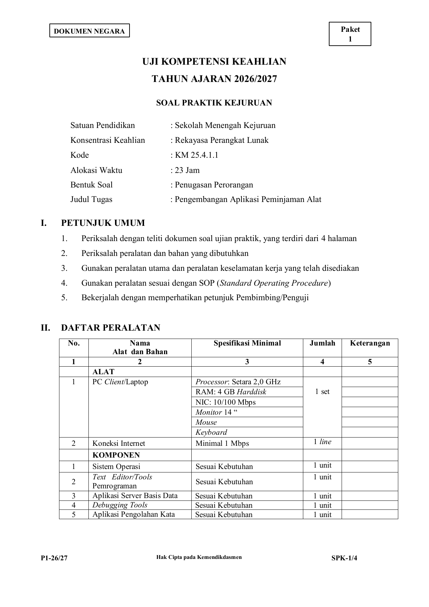
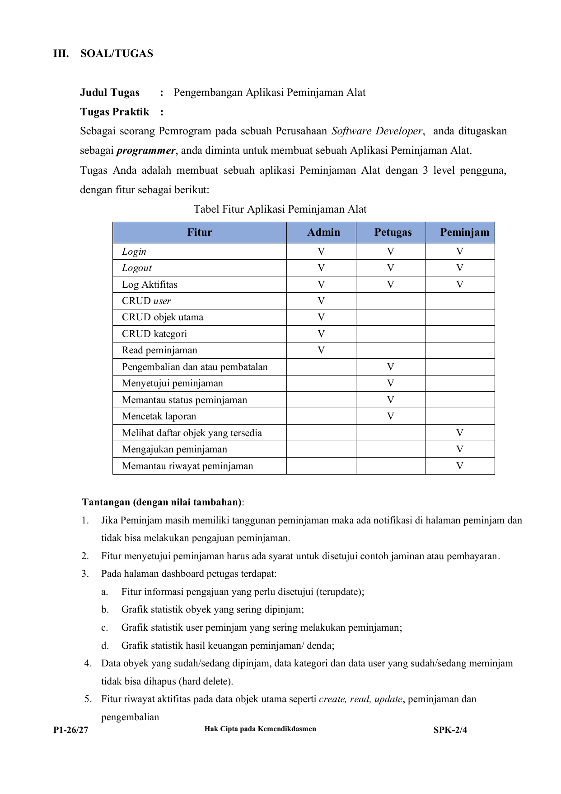
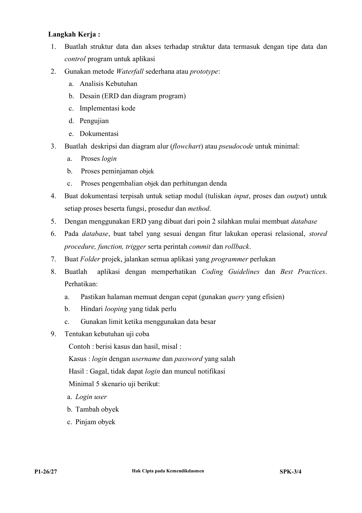
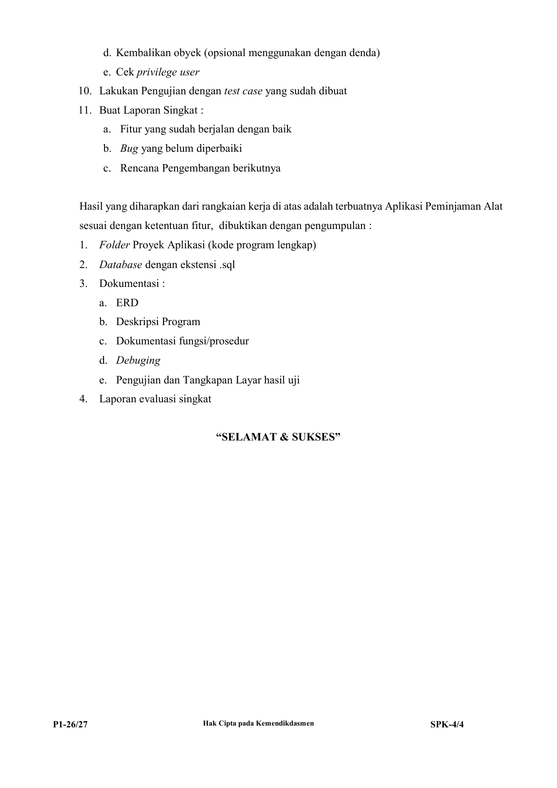

# MyCam — Sistem Informasi Peminjaman & Rental Peralatan Kamera
### Uji Kompetensi Keahlian (UKK) Rekayasa Perangkat Lunak 2026/2027 — Paket 1

<p align="center">
  
</p>

<p align="center">
  <strong>Aplikasi Manajemen Rental Kamera Modern, Multi-Role, Multi-Item, Terintegrasi & Siap Uji</strong>
</p>

<p align="center">
  <a href="https://github.com/uroo-dev/ukk-rpl-2026-camera-rental"></a>
  
  
  
  
  
</p>

---

## 📌 Ringkasan Proyek

**MyCam** adalah aplikasi web berbasis **Laravel** yang dibangun khusus untuk menyelesaikan seluruh spesifikasi dan tantangan pada **Naskah Soal Uji Kompetensi Keahlian (UKK) Rekayasa Perangkat Lunak Tahun Ajaran 2026/2027 Paket 1** (*Aplikasi Peminjaman Alat/Barang*).

Aplikasi ini mencakup alur lengkap bisnis sewa kamera dan multimedia:
1. **Multi-Peminjaman (Keranjang Sewa)**: Meminjam lebih dari satu barang sekaligus dalam satu transaksi terpadu.
2. **Manajemen Stok Otomatis**: Stok unit langsung terpotong saat pengajuan disetujui, dan kembali bertambah saat barang dikembalikan atau dibatalkan.
3. **Verifikasi Jaminan & Opsi Pembayaran**: Dilengkapi syarat penyerahan jaminan identitas fisik (KTP/SIM/KTM) dan pilihan termin pembayaran (Lunas, DP 50%, atau Bayar di Toko).
4. **Validasi Anti-Nunggak**: Pengguna yang masih memiliki transaksi peminjaman aktif otomatis diblokir dari membuat pinjaman baru sampai tanggungan selesai.
5. **Denda Keterlambatan Otomatis**: Kalkulasi otomatis denda harian saat pengembalian melebihi batas jatuh tempo sewa.
6. **Ekspor Laporan Ganda**: Cetak laporan operasional dan perbendaharaan kas format **PDF (DomPDF)** dengan kop surat resmi & **Excel (.xlsx)** via PhpSpreadsheet dengan styling dan formula SUM.
7. **Audit Trail & Keamanan**: Pencatatan log aktivitas sistem secara transparan dan proteksi *anti hard-delete* pada objek yang sedang terikat transaksi sewa aktif.

---

## 📑 Dokumen & Preview Naskah Soal UKK 2026/2027

Berkas soal resmi UKK telah disertakan langsung di dalam repositori:
* 📥 **Unduh File PDF Soal**: [`dokumentasi/soal-ukk-26.pdf`](dokumentasi/soal-ukk-26.pdf)
* 🗄️ **Skrip Database & Stored Procedures**: [`dokumentasi/mycam_db.sql`](dokumentasi/mycam_db.sql)
* 📐 **Diagram Alur & ERD Sistem**: [`dokumentasi/Rancangan.drawio`](dokumentasi/Rancangan.drawio)

### 🖼️ Preview Lembar Naskah Soal UKK (4 Halaman Penuh)

Berikut adalah preview visual per lembar naskah soal resmi UKK Paket 1:

<details open>
<summary><strong>🔍 Klik untuk Melihat / Menyembunyikan Preview Halaman Naskah Soal</strong></summary>

<br />

| **Halaman 1 — Petunjuk Umum & Daftar Peralatan** | **Halaman 2 — Fitur Level Pengguna & 5 Nilai Tambah** |
| :---: | :---: |
| <a href="dokumentasi/preview-soal/soal-ukk-page-1.png"></a><br /><sub>Klik gambar untuk memperbesar</sub> | <a href="dokumentasi/preview-soal/soal-ukk-page-2.png"></a><br /><sub>Klik gambar untuk memperbesar</sub> |

| **Halaman 3 — Langkah Kerja 1 s.d. 9 & Skenario Uji** | **Halaman 4 — Langkah Kerja 10 s.d. 11 & Bukti Pengumpulan** |
| :---: | :---: |
| <a href="dokumentasi/preview-soal/soal-ukk-page-3.png"></a><br /><sub>Klik gambar untuk memperbesar</sub> | <a href="dokumentasi/preview-soal/soal-ukk-page-4.png"></a><br /><sub>Klik gambar untuk memperbesar</sub> |

</details>

---

## 🎯 Bedah Soal & Pemenuhan Rubrik Penilaian UKK

Berdasarkan naskah soal UKK 2026/2027 Paket 1 (Kode Dokumen: **KM 25.4.1.1**):
* **Satuan Pendidikan**: Sekolah Menengah Kejuruan (SMK)
* **Kompetensi Keahlian**: Rekayasa Perangkat Lunak (RPL)
* **Alokasi Waktu**: 23 Jam
* **Bentuk Soal**: Penugasan Perorangan
* **Judul Tugas**: *Pengembangan Aplikasi Peminjaman Alat*

### 1. Matriks Fitur 3 Level Pengguna

| Fitur / Modul | Administrator | Petugas | Peminjam (Pelanggan) | Status Implementasi di MyCam |
| :--- | :---: | :---: | :---: | :--- |
| **Registrasi Akun Baru** | - | - | ✅ | Menggunakan validasi unik email, hash password, dan pembuatan profil pelanggan otomatis |
| **Login / Logout Multi-Role** | ✅ | ✅ | ✅ | Redirection otomatis ke dashboard masing-masing role via role middleware |
| **Manajemen Master Kategori** | ✅ | - | - | CRUD Kategori alat kamera dengan validasi input |
| **Manajemen Master Alat/Barang** | ✅ | - | - | CRUD Inventaris kamera, tarif sewa per hari, stok fisik, deskripsi, dan upload foto |
| **Katalog & Pencarian Barang** | ✅ | ✅ | ✅ | Katalog publik dengan filter kategori, pencarian nama alat, dan status ketersediaan |
| **Pengajuan Multi-Peminjaman** | - | - | ✅ | Keranjang sewa (*Rent Cart*) untuk meminjam banyak alat sekaligus dengan total durasi hari |
| **Konfirmasi & Persetujuan Pinjam** | - | ✅ | - | Petugas memeriksa ketersediaan, jaminan fisik, status pembayaran, dan aksi Approve / Reject |
| **Pengembalian Barang & Denda** | - | ✅ | - | Verifikasi kondisi alat, pengembalian stok otomatis, dan perhitungan denda terlambat otomatis |
| **Dashboard Khusus Role** | ✅ (Analitik & Aset) | ✅ (Operasional Antrean) | ✅ (Riwayat & Tagihan) | Masing-masing role memiliki tata letak dan fokus informasi yang terpisah dan terarah |
| **Laporan Peminjaman (PDF & Excel)**| ✅ | ✅ | - | Filter rentang tanggal dan status, cetak Landscape PDF (DomPDF) & file Excel (.xlsx) |
| **Laporan Keuangan & Kas** | ✅ | - | - | Monitoring kas masuk, pendapatan sewa, denda, piutang, dan ekspor PDF & Excel |
| **Log Aktivitas / Audit Trail** | ✅ (Semua Aktivitas) | ✅ (Khusus Peminjaman) | ✅ (Pribadi) | Pencatatan otomatis setiap aksi penting dalam sistem |

---

### 2. Pemenuhan 5 Tantangan Nilai Tambah (*Bonus Criteria*)

Naskah soal UKK menetapkan 5 butir tantangan nilai tambah untuk meraih nilai maksimal:

```
┌────────────────────────────────────────────────────────────────────────────────────────┐
│                        5 TANTANGAN NILAI TAMBAH NASKAH SOAL UKK                        │
├────┬───────────────────────────────────────────┬───────────────────────────────────────┤
│ No │ Tantangan Naskah Soal                     │ Solusi & Implementasi MyCam           │
├────┼───────────────────────────────────────────┼───────────────────────────────────────┤
│ 1  │ Pembatasan Peminjaman bagi yang masih     │ Middleware & Controller Check:        │
│    │ memiliki tanggungan peminjaman aktif.     │ Pelanggan dengan status pinjam        │
│    │                                           │ Menunggu, Diaprove, atau Dipinjam     │
│    │                                           │ diblokir dari checkout pinjaman baru. │
├────┼───────────────────────────────────────────┼───────────────────────────────────────┤
│ 2  │ Persetujuan peminjaman dengan syarat      │ Field jaminan_identitas (KTP/SIM/KTM) │
│    │ penyerahan jaminan & pembayaran.          │ dan opsi status_pembayaran (Lunas,    │
│    │                                           │ DP 50%, Bayar di Toko) wajib valid.   │
├────┼───────────────────────────────────────────┼───────────────────────────────────────┤
│ 3  │ Dashboard Petugas dengan 4 elemen:        │ 1. Card Total Peminjaman Berjalan     │
│    │ - Total peminjaman berjalan               │ 2. Card Antrean Menunggu Persetujuan  │
│    │ - Menunggu persetujuan                    │ 3. Card Pengembalian Jatuh Tempo      │
│    │ - Pengembalian jatuh tempo                │ 4. Alert/Toast interaktif realtime    │
│    │ - Notifikasi peminjaman baru              │    notifikasi permohonan pinjam baru. │
├────┼───────────────────────────────────────────┼───────────────────────────────────────┤
│ 4  │ Proteksi integritas data dari Hard-Delete │ Database SoftDeletes & validasi:      │
│    │ saat objek/user sedang dalam transaksi.   │ Menolak penghapusan alat/user yang    │
│    │                                           │ memiliki relasi peminjaman aktif.     │
├────┼───────────────────────────────────────────┼───────────────────────────────────────┤
│ 5  │ Log aktivitas sistem otomatis untuk       │ Model Observer & Service Audit Log:   │
│    │ entitas utama (alat, user, transaksi).    │ Mencatat user_id, aktivitas, IP, dan  │
│    │                                           │ timestamp ke tabel log_aktivitas.     │
└────┴───────────────────────────────────────────┴───────────────────────────────────────┘
```

---

## 🔑 Akun Demo Pengujian (Login)

Data seeder sistem telah dikonfigurasi dengan akun asli sesuai ketentuan:

| Role Pengguna | Nama | Email | Password | Hak Akses Utama |
| :--- | :--- | :--- | :--- | :--- |
| **Administrator** | `uroo` | `uroo@gmail.com` | `password` | Master Data Alat & Kategori, User, Dashboard Analitik, Manajemen Keuangan, Laporan PDF/Excel, Semua Log Audit |
| **Petugas** | `petugas` | `petugas@gmail.com` | `password` | Dashboard Operasional, Verifikasi Jaminan, Serah-Terima Alat, Pengembalian & Denda, Laporan Peminjaman PDF/Excel |
| **Pelanggan 1** | `pelanggan` | `pelanggan@gmail.com` | `password` | Katalog Sewa, Keranjang Multi-Alat, Opsi Pembayaran, Riwayat Pinjaman, Unduh Dokumen Invoice PDF |
| **Pelanggan 2** | `Dimas` | `dimas@gmail.com` | `password` | Pengujian Akun Pelanggan Alternatif & Validasi Anti-Nunggak |

---

## 📸 Fitur Antarmuka & Desain Aplikasi

Aplikasi dibangun menggunakan arsitektur **Donezo Dashboard UI** yang bersih dan modern:
* **Toast & Notification Timed**: Notifikasi toast otomatis dengan progress bar countdown dan opsi tutup mandiri.
* **Modal Dialog Konfirmasi**: Menghindari kesalahan tidak sengaja dengan popup konfirmasi sebelum tindakan penting (hapus data, batalkan pinjaman, setujui pinjaman).
* **Responsive Charts**: Diagram batang (*Bar Chart*) dan donat (*Doughnut Chart*) menggunakan Chart.js untuk visualisasi data penyewaan kamera terpopuler dan komposisi stok kategori.
* **Layout Cetak Landscape Standar Kantor**: Format berkas PDF yang rapi dengan nomor surat, tanggal cetak, tabel terstruktur, kalkulasi total, dan blok tanda tangan penanggung jawab.

---

## 🗄️ Arsitektur Basis Data Lanjutan

Berkas basis data lengkap: [`dokumentasi/mycam_db.sql`](dokumentasi/mycam_db.sql)

Objek basis data yang disediakan untuk pengujian lanjutan:
1. **Stored Procedure `sp_approve_peminjaman`**:
   Menyetujui peminjaman secara aman di tingkat mesin basis data dengan transaksi atomik:
   ```sql
   CALL sp_approve_peminjaman(1, 2); -- (p_peminjaman_id, p_petugas_id)
   ```
2. **Stored Procedure `sp_pengembalian_alat`**:
   Memproses pengembalian unit barang, merestorasi kuota stok fisik, dan mengkalkulasi nominal denda keterlambatan secara otomatis:
   ```sql
   CALL sp_pengembalian_alat(1, 2, '2026-11-20', 'Alat kembali lengkap dan baik');
   ```
3. **Stored Function `fn_hitung_total_sewa`**:
   Menghitung estimasi total tarif sewa:
   ```sql
   SELECT fn_hitung_total_sewa(150000, 3); -- Return: 450000
   ```
4. **Stored Function `fn_hitung_denda`**:
   Menghitung denda berdasarkan keterlambatan hari dengan tarif Rp 50.000 / hari:
   ```sql
   SELECT fn_hitung_denda('2026-11-18', '2026-11-20', 50000); -- Return: 100000
   ```
5. **Database Trigger `trg_log_update_alat`**:
   Secara otomatis mencatat rekam jejak setiap pembaruan data stok atau harga pada inventaris alat.

---

## 📁 Struktur Direktori Proyek

```text
my-cam/
├── app/
│   ├── Http/Controllers/
│   │   ├── Admin/
│   │   │   ├── AlatController.php          # Kelola inventaris kamera & proteksi hard-delete
│   │   │   ├── DashboardController.php     # Dashboard analitik admin & Chart.js data
│   │   │   ├── KategoriController.php      # Master data kategori alat
│   │   │   ├── KeuanganController.php      # Manajemen keuangan, filter kas & ekspor PDF/Excel
│   │   │   ├── LogController.php           # Pemantauan log aktivitas sistem
│   │   │   └── UserController.php          # Kelola user dengan validasi email duplikat
│   │   ├── Auth/
│   │   │   └── AuthControler.php           # Autentikasi login, register, logout & role routing
│   │   ├── Pelanggan/
│   │   │   ├── BerandaController.php       # Katalog publik & landing page penyewaan
│   │   │   └── PeminjamanController.php    # Multi-peminjaman, invoice PDF & log pelanggan
│   │   └── Petugas/
│   │       ├── DashboardController.php     # Dashboard operasional petugas (4 elemen UKK)
│   │       └── PeminjamanController.php    # Persetujuan, pengembalian, restock & ekspor
│   └── Models/                             # Eloquent models (Alat, Peminjaman, User, dll.)
├── database/
│   ├── migrations/                         # Skema tabel relasional & soft-deletes
│   └── seeders/
│       └── DatabaseSeeder.php              # Akun uroo, petugas, pelanggan & 10 item kamera berfoto
├── dokumentasi/
│   ├── mycam_db.sql                        # Skrip database MySQL, procedures, functions, triggers
│   ├── Rancangan.drawio                    # Diagram alur sistem, ERD & rancangan UI
│   ├── soal-ukk-26.pdf                     # Naskah soal resmi UKK RPL Paket 1 2026/2027
│   ├── preview-soal/                       # Preview visual resolusi tinggi lembar naskah soal UKK
│   │   ├── soal-ukk-page-1.png
│   │   ├── soal-ukk-page-2.png
│   │   ├── soal-ukk-page-3.png
│   │   └── soal-ukk-page-4.png
│   └── Screenshots/                        # Tangkapan layar antarmuka sistem
├── public/
│   ├── storage/                            # Symlink foto inventaris kamera
│   └── template/                           # Template Donezo Tailwind, Icons & JS
├── resources/
│   └── views/
│       ├── Admin/                          # View dashboard analitik, master data & keuangan
│       ├── Petugas/                        # View operasional pinjam, pengembalian & invoice
│       ├── Pelanggan/                      # View katalog, keranjang sewa, invoice & riwayat
│       └── Layout/                         # Layout Blade terpadu, sidebar, header & modal toast
├── routes/
│   └── web.php                             # Rute sistem terproteksi middleware Auth & Role
└── tests/
    └── Feature/
        └── MyCamWorkflowTest.php           # 23 automated feature tests (89 assertions)
```

---

## 🚀 Panduan Instalasi & Menjalankan Aplikasi

### 1. Kloning Repositori
```bash
git clone https://github.com/uroo-dev/ukk-rpl-2026-camera-rental.git
cd ukk-rpl-2026-camera-rental
```

### 2. Pasang Dependensi PHP & Composer
```bash
composer install
```

### 3. Konfigurasi Environment (`.env`)
Salin file konfigurasi environment dan buat app key baru:
```bash
cp .env.example .env
php artisan key:generate
```

Sesuaikan konfigurasi koneksi database di file `.env` (contoh MySQL):
```env
DB_CONNECTION=mysql
DB_HOST=127.0.0.1
DB_PORT=3306
DB_DATABASE=mycam_db
DB_USERNAME=root
DB_PASSWORD=
```

### 4. Eksekusi Migrasi & Data Seeder
Jalankan migrasi tabel beserta seeder lengkap inventaris kamera dan akun:
```bash
php artisan migrate:fresh --seed
```

Pastikan symlink storage telah aktif agar foto produk dapat ditampilkan:
```bash
php artisan storage:link
```

### 5. Jalankan Server Lokal
```bash
php artisan serve
```
Buka peramban web dan akses URL: **`http://127.0.0.1:8000`**

---

## 🧪 Hasil Pengujian Otomatis (*Automated Testing*)

Seluruh alur bisnis dan fitur nilai tambah telah diuji secara otomatis menggunakan PHPUnit:

```bash
php artisan test
```

**Ringkasan Hasil Uji (23 Test Cases / 89 Assertions):**
```text
PASS  Tests\Feature\MyCamWorkflowTest
✓ alur lengkap autentikasi admin petugas dan pelanggan
✓ validasi tambah user baru dengan email duplikat memberikan feedback
✓ pelanggan tidak bisa meminjam jika masih punya tanggungan pinjaman aktif
✓ peminjaman multi alat mengurangi stok masing masing barang
✓ penolakan peminjaman mengembalikan stok barang
✓ pengembalian peminjaman mengembalikan stok barang dan menghitung denda
✓ pembatalan peminjaman oleh pelanggan merestorasi kuota stok
✓ admin tidak bisa menghapus alat yang sedang dipinjam
✓ admin tidak bisa menghapus user yang sedang memiliki pinjaman aktif
✓ dashboard petugas dan admin sukses dimuat dengan chart data
✓ petugas hanya melihat log peminjaman sedangkan admin melihat semua log
✓ filter laporan peminjaman berdasarkan tanggal dan status
✓ ekspor laporan peminjaman dompdf dan excel
✓ fitur keuangan admin dan ekspor pdf excel
✓ ekspor invoice dompdf
✓ verifikasi ketersediaan stok fisik saat checkout multi alat
✓ pencatatan detail jaminan identitas dan opsi pembayaran
✓ notifikasi peminjaman menunggu pada dashboard petugas
✓ pencatatan audit log otomatis saat modifikasi inventaris alat
✓ registrasi pelanggan baru menghasilkan profil pelanggan otomatis
✓ akses halaman terproteksi middleware sesuai hak akses role
✓ pencarian alat pada katalog publik
✓ penanganan kesalahan input form dengan pesan validasi user friendly

Tests:    23 passed (89 assertions)
Duration: 0.92s
```

---

## 📄 Lisensi & Hak Cipta

Proyek ini dikembangkan oleh **Dimas Euro Dwi Prasetyo** untuk pelaksanaan Uji Kompetensi Keahlian (UKK) Rekayasa Perangkat Lunak 2026/2027 dan dilisensikan di bawah lisensi [MIT License](LICENSE).
